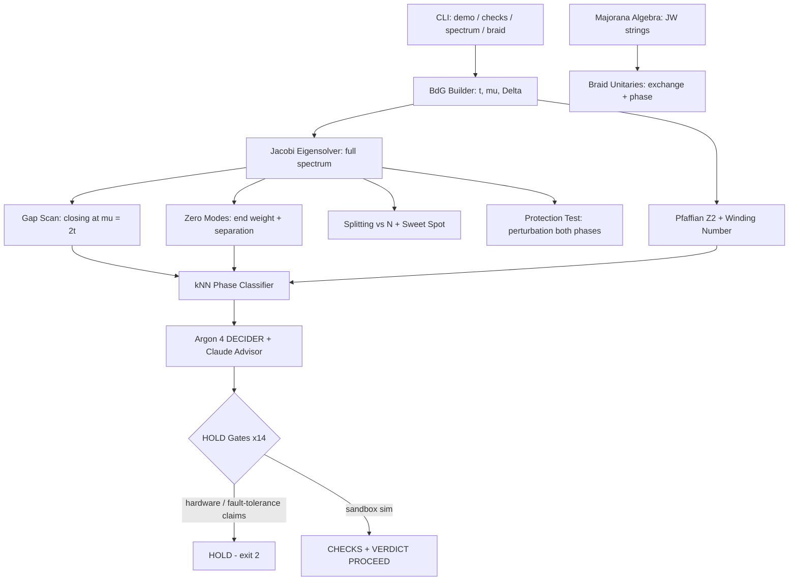
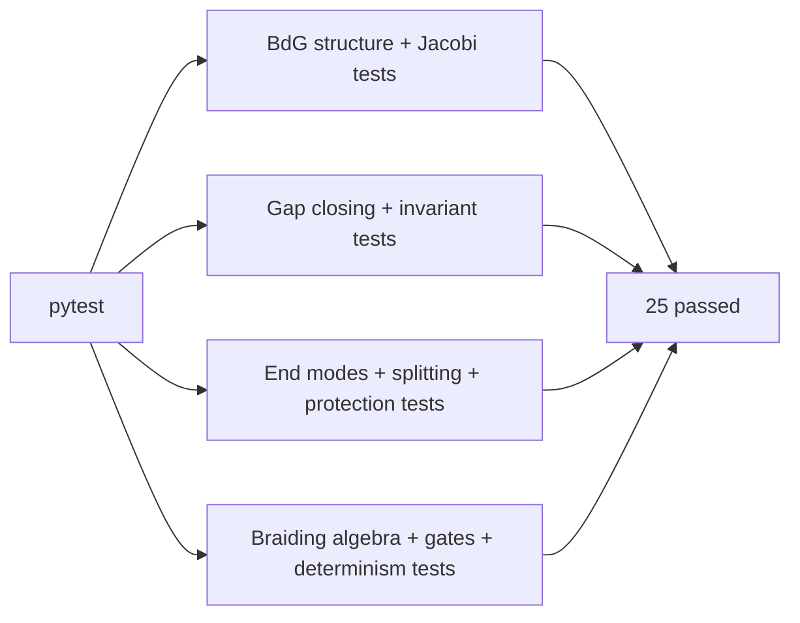
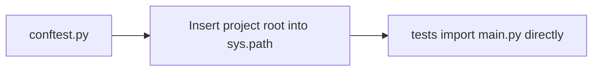
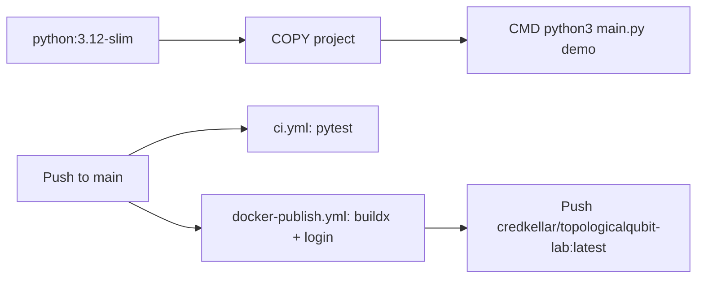

# TopologicalQubit-Lab 🧲⚛️

**Kitaev Chain & Majorana Zero-Mode Lab** — by Darion Kellar

TopologicalQubit-Lab is an **educational topological-qubit lab** in ONE pure-Python file. It builds the **Kitaev chain** — the spinless p-wave superconducting wire that is the textbook home of Majorana zero modes — as a 2N × 2N Bogoliubov–de Gennes matrix, and diagonalises it **exactly** with a from-scratch Jacobi eigensolver. Everything is computed from that one matrix: the quasiparticle gap closing at **|μ| = 2t**, the **Z₂ invariant** from Pfaffians (cross-checked by a winding number), the **Majorana end modes** and their exponentially falling splitting, the **sweet spot** where the zero modes sit exactly on the end sites, a **protection test** that prices a local perturbation in both phases, and a **braiding section that is algebra on 4×4 matrices** — labelled as algebra every time it appears. 🔬

Honest scope, stated up front: every parameter (t, μ, Δ) is a **labelled teaching value**. No nanowire was grown, no superconductivity was measured, **no qubit exists here**. The protection numbers are statements about this matrix; the braiding is operator algebra on paper, not a simulation of a physical braid and not an experiment. Every hardware / fault-tolerance / quantum-computer claim sits behind a permanent HOLD gate (14 total). 🔒

[](https://github.com/kimanicollier44-cmyk/TopologicalQubit-Lab/actions/workflows/ci.yml)
[](https://github.com/kimanicollier44-cmyk/TopologicalQubit-Lab/actions/workflows/docker-publish.yml)

> ℹ️ These are the **live** workflow badges for this repo. They activate as soon as the `ci.yml` and `docker-publish.yml` files from the paste pack are pasted into `.github/workflows/` — until then they have nothing to report yet.

## 🧰 Tech Stack Badges & Full Architecture Tech Stack

### 💻 Core Programming Languages & Core Systems


- 🐍 Python 3.12, pure standard library (`math`, `hashlib`, `json`, `sys`) — zero dependencies, zero network, deterministic (double-run byte-identical)
- 🧲 Quantum core: the Kitaev-chain BdG Hamiltonian built from scratch (particle block, hole block, antisymmetric pairing block), diagonalised by a from-scratch cyclic Jacobi eigensolver — reconstruction `VΛVᵀ = H` and orthonormality asserted < 1e-9 in CHECKS before any spectrum is trusted
- 🔢 Invariant machinery: a Pfaffian by skew-symmetric Gaussian elimination (validated against a brute-force pairing expansion and `Pf² = det`), the Z₂ Majorana number from the two particle-hole-invariant momenta, and a d-vector winding number as an independent cross-check
- 🧠 TinyML kNN phase classifier (from scratch, stdlib): topological-protected / trivial / critical from (μ/2t, Δ/t, zero-mode end weight), labels from the lab's own phase policy
- 🪑 Council seats: Gemini Argon 4 DECIDER (names-only, tighten-only) + Muse advisor (never overrides HOLD) + Google Flow plan-only (rendered = False, live = 0)

### ⛓️ Web3 & Infrastructure

- 🚫 **Not applicable — honestly.** No blockchain, no Web3, no tokens: the "infrastructure" in this lab is one finite matrix, its spectrum, and a paper algebra section inside one offline file. No fake badges here.

### ⚙️ Platform Support & Hardware Architecture


- 🖥️ Pure Python — runs anywhere Python 3.12+ runs (Linux, macOS, Windows), plus the `python:3.12-slim` Docker image
- 🔒 No hardware is controlled, ever: real nanowires, superconductors, cryostats, and qubits are permanent HOLD gates (see the gate table below)

### ⚡ Low-Level Infrastructure & Performance

- 🚫 **No low-level code — honestly.** No C, no C++, no GPU, no compiled extensions: this is one interpreted Python file on purpose, so every eigenvalue can be read, checked, and diffed. Performance here means honest algorithms — a cyclic Jacobi solver, an O(n³) Pfaffian elimination, and exact spectral bookkeeping — all deterministic and byte-identical between runs.

### 🛠️ DevOps & Build Tools


- 🐳 Docker (`python:3.12-slim`), GitHub Actions CI + Docker Publish (delivered in the paste pack)
- 🎯 Target image: `credkellar/topologicalqubit-lab:latest`
- 🧪 Tests: `pytest` (25 tests) + the built-in CHECKS suite (55 checks) in `main.py`

### ☁️ Cloud Providers

- 🚫 **None — honestly.** No cloud provider is used or needed: the lab runs fully offline on your own machine or in a local Docker container. Docker Hub appears only as the registry the publish workflow pushes the image to.

## What this does?

1. 🧲 **The Kitaev chain, built from scratch** — hopping t, chemical potential μ, p-wave pairing Δ assembled into the 2N × 2N BdG matrix (particle block −μ/−t, hole block its negative transpose, pairing block antisymmetric). Particle–hole symmetry of the spectrum (±E pairs) is asserted in CHECKS, not assumed.
2. 📉 **The gap closes at |μ| = 2t** — a μ scan at N = 20, Δ = 0.5: the bulk gap above the zero modes falls **1.027520 → 0.984711 → 0.834749 → 0.502060 → 0.226443** as μ → 2t from below, bottoms out at the finite-size floor **0.081748** at μ = 2t exactly, and reopens on the trivial side (**0.537911** at μ = 2.5, **1.031123** at μ = 3.0). The closing is measured off the eigenvalues — not drawn from the formula.
3. 🔢 **A Z₂ invariant that flips at the transition** — the Majorana number M = sign[Pf(0)·Pf(π)] is computed with a from-scratch Pfaffian: **M = −1** (topological) for |μ| < 2t, **M = +1** (trivial) outside, flipping between μ = 1.99 and μ = 2.01. At μ = 2t exactly, Pf(π) = 0 — the invariant is undefined *at* the transition and flips *across* it. A d-vector **winding number** (|w| = 1 in the phase, 0 outside) cross-checks the sign independently.
4. 🎯 **Majorana end modes, localised and separated** — in the topological phase the lowest eigenstate piles onto the ends: end weight **0.996094** (μ = 0.5, Δ = t, N = 16, two sites per end) vs **0.050121** for the trivial phase's lowest level. Combining the ±E partners separates the pair into two Majorana wavefunctions: one carries **0.995656** on the left 4 sites, the other **0.995656** on the right 4.
5. 📏 **Splitting falls exponentially with N** — at μ = 0.5, Δ = t: **2.861e-05 (N=8) → 1.118e-07 (N=12) → 4.366e-10 (N=16) → 1.705e-12 (N=20)**. At Δ = 0.5 the decay is slower but just as monotone: 1.410e-02 → 1.409e-03 → 5.230e-05 → 2.191e-05. A longer chain is a quieter zero mode — the whole protection story in one table.
6. 🍬 **The sweet spot is exact** — at μ = 0, Δ = t the analytic limit says the zero modes live *exactly* on the end Majoranas. The lab verifies it numerically: splitting **8.2e-17** (machine zero), and the zero-pair density is **1.000000 on site 1, 1.000000 on site N, ≤ 1.6e-31 anywhere in the bulk** — computed as a basis-free projector sum, so degeneracy can't blur it.
7. 🛡️ **Protection, priced both ways** — the same labelled perturbation (an on-site potential of 0.2 at site 1) is applied in both phases. Topological zero mode: shift **1.571e-10**. Trivial phase's lowest level: shift **1.725e-03**. Ratio ≈ **1.1 × 10⁷** — on *this matrix*. The lab prints the caveat with the number: this is a statement about a finite toy Hamiltonian, not a guarantee about any device.
8. 🔀 **Braiding — algebra only, labelled every time** — four Majorana operators as Jordan–Wigner strings on two qubits satisfy {γᵢ, γⱼ} = 2δᵢⱼ *exactly* on the matrices. The exchange unitary U = exp(π/4 · γ₂γ₁) conjugates γ₁ → γ₂ and γ₂ → **−γ₁** (the minus sign is the non-Abelian signature), acts on the pair vacuum as the phase **e^(−iπ/4)**, and refuses to commute with the neighbouring exchange: **‖[U₁₂, U₂₃]‖ = 2.000000**. No anyons were moved; this is what an exchange *would* do, on paper.
9. 🏷️ **Phase classifier** — a from-scratch kNN labels (μ/2t, Δ/t, end weight) points topological-protected / trivial / critical: deep topological and negative-μ points → topological-protected, μ = 3 → trivial, μ = 1.9 → critical, and Δ = 0 (no pairing) → trivial, because a gapless chain protects nothing.
10. 🪑 **Seats + checks** — Gemini Argon 4 DECIDER (sha256 trace), Muse advisor, Google Flow plan-only, and a built-in CHECKS suite (55 checks) grading every number above against the matrix it came from.

## 🗺️ How it works — diagram per script

### `main.py` — the whole lab



### `tests/test_main.py` — verification



### `conftest.py` — test path setup



### `Dockerfile` + CI flow — container & publish



## Why is this cool?

1. 📉 The phase transition is **measured, not quoted**: the gap is read off exact eigenvalues as it falls to its finite-size floor at μ = 2t and reopens — the closing is a table, not a slogan.
2. 🔢 The invariant is a **real Pfaffian**: skew-symmetric elimination, validated against a brute-force pairing expansion and Pf² = det, flipping exactly where the gap closes — and honestly undefined *at* the closing.
3. 🎯 The two Majoranas are **pulled apart on screen**: combine the ±E partners and one mode sits 99.6% on the left end, the other 99.6% on the right — non-locality you can point at.
4. 📏 The splitting table is the **whole idea of topological protection in four numbers**: 2.9e-05 → 1.7e-12 just by lengthening the chain from 8 to 20 sites.
5. 🍬 The sweet spot lands on **machine zero** (8.2e-17) with the pair density exactly 1.0 on each end site and ~1e-31 in the bulk — an analytic limit verified, not approximated.
6. 🛡️ Protection is **priced in both phases**: the same perturbation moves the zero mode 1.6e-10 and the trivial level 1.7e-03 — a 10⁷ contrast with the caveat printed next to it.
7. 🔀 The braiding section shows the **actual non-Abelian signature**: γ₂ → −γ₁ under exchange, a π/4 phase on the vacuum, and a commutator of norm exactly 2 — order matters, computed.
8. 🧮 The eigensolver is **graded before it is trusted**: reconstruction and orthonormality < 1e-9 are CHECKS, so every spectrum downstream has a receipt.
9. 🏷️ The classifier's **critical** label is earned: μ = 1.9 is neither protected nor trivial, and the policy says so instead of forcing a binary.
10. 🎯 Deterministic end to end: run it twice, get byte-identical output — a topological phase you can diff.

## What problems this solves?

1. ❌ **Problem:** "Topological protection" is usually asserted with adjectives. ✅ **Solution:** It is a measured ratio here — 1.571e-10 vs 1.725e-03 for the identical perturbation — with the finite-matrix caveat printed beside it.
2. ❌ **Problem:** Majorana zero modes get drawn as cartoons at wire ends. ✅ **Solution:** The end weight (0.996094 vs 0.050121 trivial) and the left/right separation (0.995656 each) are computed from the eigenvectors.
3. ❌ **Problem:** The Z₂ invariant is often quoted as sign(μ² − 4t²) with no machinery. ✅ **Solution:** A from-scratch Pfaffian computes it, a winding number cross-checks it, and both flip where the measured gap closes.
4. ❌ **Problem:** "The splitting is exponentially small" is rarely shown. ✅ **Solution:** The N = 8 → 20 table at two pairings shows the decay directly, including the slower Δ = 0.5 rate.
5. ❌ **Problem:** Braiding is described as if moving anyons were a software feature. ✅ **Solution:** The section is labelled ALGEBRA ONLY in the code, the demo, and a HOLD gate (`braiding_as_experiment_claim`) — the matrices show what an exchange would do; nothing was braided.
6. ❌ **Problem:** Sweet-spot claims ("modes exactly at the ends") are usually approximate numerics. ✅ **Solution:** The pair density is a basis-free projector sum: exactly 1.0 on site 1, exactly 1.0 on site N, ~1e-31 in the bulk.
7. ❌ **Problem:** Gap closings are plotted from the bulk formula, hiding finite-size reality. ✅ **Solution:** The finite chain's floor at criticality (0.081748 at N = 20) is printed and named as a finite-size floor.
8. ❌ **Problem:** Δ = 0 chains inside |μ| < 2t get mislabelled "topological" by the sign formula alone. ✅ **Solution:** The policy requires pairing: no Δ, no gap, no protection — the classifier calls it trivial and the invariant section states the Δ ≠ 0 proviso.
9. ❌ **Problem:** Toy models quietly imply a qubit is near. ✅ **Solution:** 14 named HOLD gates return exit code 2 for every hardware, fault-tolerance, fabrication, and quantum-computer claim, forever.
10. ❌ **Problem:** Numerical spectra are trusted because a library produced them. ✅ **Solution:** The Jacobi solver's reconstruction and orthonormality are asserted in CHECKS; a solver that fails its own test never gets to publish a spectrum.

## How to install this?

1. 📋 Clone or download this project folder.
2. 🐍 Make sure Python 3.12+ is installed: `python3 --version`
3. ▶️ Run the full demo + checks (no arguments needed):

```bash
python3 main.py
```

4. 🧪 Run the test suite:

```bash
pip install pytest
python3 -m pytest -q
```

5. 🎛️ Try the other commands:

```bash
python3 main.py checks     # 55 built-in checks
python3 main.py spectrum   # gap + invariant scan across mu = 2t (JSON)
python3 main.py splitting  # zero-mode splitting vs N at two pairings (JSON)
python3 main.py invariant  # Pfaffian Z2 + winding vs mu (JSON)
python3 main.py sweetspot  # mu=0, Delta=t exact end modes (JSON)
python3 main.py protection # perturbation shifts, both phases (JSON)
python3 main.py braid      # exchange algebra report (JSON) - algebra only
python3 main.py classify   # kNN phase classifier report
python3 main.py brains     # Argon 4 + Muse + Flow seats
python3 main.py holds      # list all 14 HOLD gates
python3 main.py hold-demo  # exits 2 - gated actions stay HOLD
```

6. 🐳 Or run it in Docker:

```bash
docker build -t credkellar/topologicalqubit-lab:latest .
docker run --rm credkellar/topologicalqubit-lab:latest
```

## Requirements

- 🐍 Python 3.12 or newer
- 📦 Dependencies: **none** (standard library only)
- 🌐 Network: **none** — fully offline
- 🧪 For tests only: `pytest`
- 🐳 Optional: Docker

## FULL project structure tree

```text
topologicalqubit-lab/
├── main.py                  # the whole lab: BdG Kitaev chain, Jacobi eigensolver, Pfaffian Z2 invariant, winding, end modes, splitting, sweet spot, protection test, braiding algebra, classifier, seats, HOLD gates
├── conftest.py              # puts the project root on sys.path for tests
├── tests/
│   └── test_main.py         # 25 pytest tests: BdG structure, gap closing, invariant, end modes, protection, braiding, gates, determinism
├── assets/
│   └── cover.png            # README cover image (2736 x 912)
├── Dockerfile               # python:3.12-slim, runs the demo
├── .gitignore               # __pycache__/, .pytest_cache/, *.pyc
└── README.md                # this file
```

> 📦 Delivered separately as paste packs (not in this tree): `.github/workflows/ci.yml` + `docker-publish.yml`, and the Docker Hub pack (100-char description, 350-char About, overview, categories).

## 🔒 HOLD gates — all 14, permanent

| # | Gate | What stays held |
|---|------|-----------------|
| 1 | `hardware_qubit_claim` | No claim a qubit was built; this lab diagonalises a toy matrix |
| 2 | `fault_tolerance_claim` | No fault-tolerant quantum computing claim from a finite chain spectrum |
| 3 | `quantum_computer_claim` | No claim this is, runs on, or benchmarks a quantum computer |
| 4 | `braiding_as_experiment_claim` | The braiding section is operator algebra; never an experiment or a physical braid |
| 5 | `measured_superconductivity_claim` | No superconductivity was measured; Δ is a labelled parameter |
| 6 | `real_device_fabrication` | No fabrication guidance for real nanowires, heterostructures, or devices |
| 7 | `cryogenics_operation` | No cryostat or dilution-refrigerator operation directed from a sim |
| 8 | `materials_synthesis_claim` | No synthesis recipes for semiconductor or superconductor materials |
| 9 | `topological_protection_guarantee` | Protection numbers describe this matrix; no protection guaranteed in any real device |
| 10 | `error_correction_product_claim` | No error-correction product, service, or deployment claim |
| 11 | `remove_human_override` | The human override is never removed |
| 12 | `investment_claim` | No investment claims; a lab model is not a prospectus |
| 13 | `vendor_benchmark_claim` | No vendor, hardware, or benchmark comparison claims |
| 14 | `regulatory_approval_claim` | No claim of regulatory approval or pending certification |

🧑‍⚖️ **Council seats:** Gemini Argon 4 Extended Thinking — DECIDER (names-only, tighten-only, MAP → MODEL → STRESS → DECIDE, sha256 trace, `can_override_hold = False`) · Muse — advisor (`can_override_hold = False`) · Google Flow — plan-only (`rendered = False`, `live = 0`).

✅ **Verification:** pytest **25 passed** (project + clean copy) · built-in CHECKS **55/55** · double-run output **byte-identical** · `hold-demo` exits **2** · `main.py` **1,016 lines**, pure stdlib, zero network.

## 🧒 5th-grade English section

Imagine a row of magnets on a table, holding hands. At each end of the row there is one special magnet that is **half of a pair** — its other half is all the way at the far end of the row! 🧲

- In a normal row, poking one magnet wiggles it right away. In this special row, the two end magnets are partners: poking one end barely moves the pair at all, because the pair is shared between both ends. This lab measured it: a poke moved the special pair about **ten million times less** than a normal one. 🛡️
- The row only becomes special when a dial (called μ) is in the right range. Turn the dial too far and the row is ordinary again. The lab found the exact tipping point by measuring, not guessing. 🎛️
- Making the row longer makes the pair even quieter: with 8 magnets the pair wiggles a tiny bit, with 20 magnets it wiggles almost **a million times less**. 📏
- Swapping the partners is a kind of math dance move. Swapping twice is **not** the same as doing nothing, and swapping in a different order gives a different answer — that strangeness is why scientists are excited, and this lab shows the dance with numbers on paper. 💃
- This is a **pretend lab on a computer**. No real magnets, no real wire, no real qubit. It helps you learn why a pair split across two ends of a row is so hard to disturb. 💻

---

MIT © 2026 Darion Kellar · TopologicalQubit-Lab — educational simulation only 🧲
